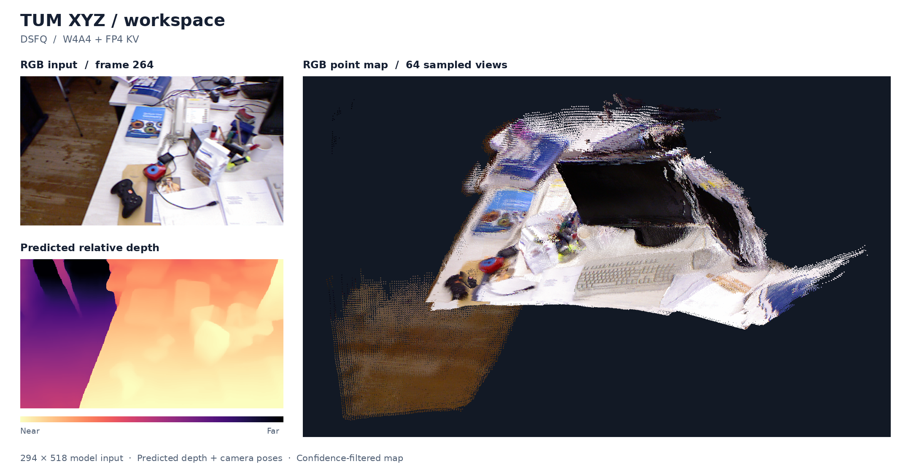
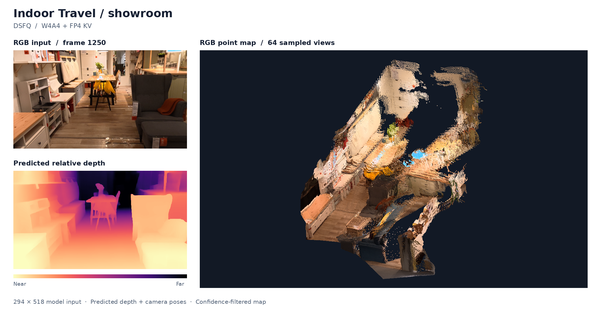
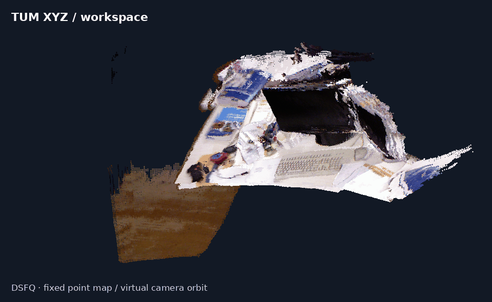
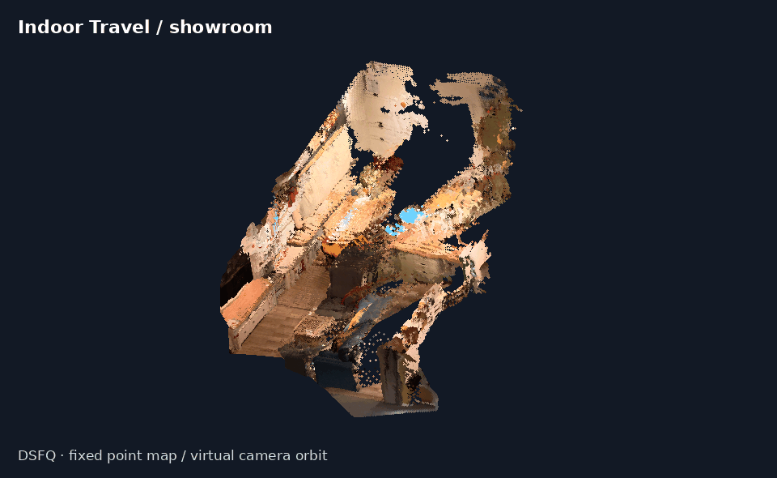
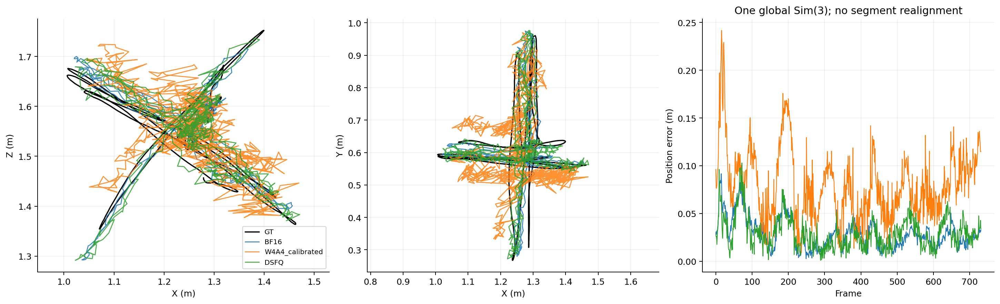
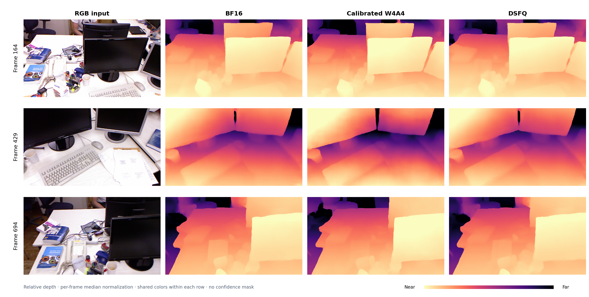
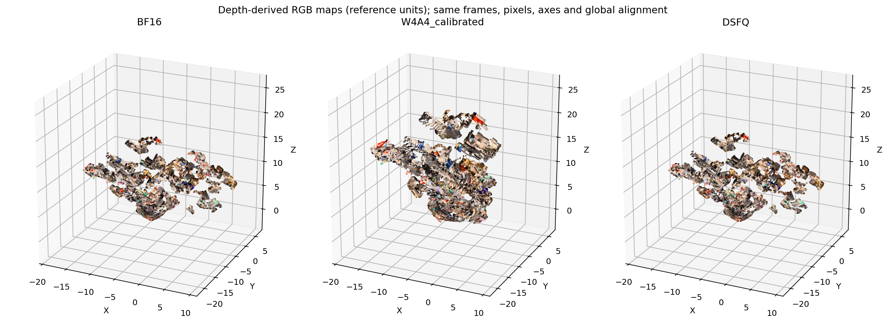

<p align="center"></p>

<h1 align="center">Quantized LingBot-Map</h1>

<p align="center">BF16 · Calibrated W4A4 · DSFQ<br><a href="README_zh.md">中文</a> | English</p>

A compact post-training quantization and inference project built on [LingBot-Map](https://github.com/Robbyant/lingbot-map). It compares three methods for streaming 3D mapping, with shared image processing and window settings.

[GitHub source](https://github.com/shuinb/Quantized-LingBot-Map) · [DSFQ weights and results on Hugging Face](https://huggingface.co/shuinb/Quantized-LingBot-Map)

## What changed

| Method | GCT Linear layers | Calibration | GCT KV storage |
|---|---|---|---|
| BF16 | BF16 | None | BF16 operands used by SDPA |
| Calibrated direct W4A4 | Packed W4, per-token A4 | LWC/LAC: learned weight/activation clipping; no rotation or smoothing | FP4 |
| DSFQ, current method | Packed W4, per-token A4 | Hadamard rotation + channel smoothing + learned clipping | FP4 |

- Quantize 192 GCT Linear layers. DINO stays BF16; camera and depth heads stay FP32. Attention uses BF16 SDPA.
- Calibrate both quantized methods on the same independent desk/rpy clips: 320 frames, six captured streaming states per block, 15 reconstruction epochs. Original model weights are not trained.
- Reduce peak memory through compressed KV, deferred cache allocation, chunked initialization and CUDA Graphs. Keep 294×518 inputs, eight anchors, 64-frame local history and keyframe interval two.

## Reconstruction gallery





<p align="center"> </p>

Fresh DSFQ inference on **GPU0: 732 XYZ frames** and **GPU1: 496 Indoor frames**, using the published weights and 294×518 inputs. These are curated local views: XYZ frames **200–327** and Indoor frames **1216–1279**. Each map samples 64 views with pixel stride 2 and removes the lowest 20% of depth confidence per frame. The GIFs move a virtual camera around a fixed predicted point map; they do not show online reconstruction speed. RGB/depth panels are unmasked; depth colors saturate at the 2nd/98th percentiles. No GT geometry, mesh filling or recalibration is used. [Rendering details](results/gallery.json) · [Reproduce the gallery](docs/visualization.md).

## Results and comparison

TUM fr1/xyz, 732 frames; lower is better:

| Method | GT ATE (cm) | Translation RPE (cm) | Rotation RPE (°) | Depth AbsRel (%) |
|---|---:|---:|---:|---:|
| BF16 | 3.312 | 0.826 | 0.362 | 4.149 |
| Calibrated W4A4, FP4 KV | 8.805 | 3.844 | 0.966 | 5.600 |
| **DSFQ** | **3.389** | **1.561** | **0.559** | **4.206** |

The calibrated W4A4 row above uses **direct LWC/LAC + FP4 KV**. With otherwise matched settings and BF16 KV, calibration reduces XYZ ATE from **8.180 to 6.183 cm**; with FP4 KV, it changes **7.714 to 8.805 cm**. The BF16 KV control uses about 9.03 GB of peak PyTorch allocated memory. These results cover this particular calibration recipe and cache configuration. [Audit data](results/calibration_audit.json) · [Diagnostic figure](assets/calibration_audit.png).





The depth grid shows XYZ frames 164, 429 and 694. Each method/frame is divided by its own median depth; all methods then share the BF16 2nd/98th-percentile color limits within each row, without confidence masking. This displays relative shape, not metric scale or ground-truth error. [PDF](assets/depth_comparison.pdf).

Indoor Travel RGB maps from 64 evenly sampled frames of the 5,000-frame sequence:



Restoring BF16 KV does not resolve the direct W4A4 drift on Indoor: ATE versus BF16 is 6.041 with BF16 KV and 5.241 with FP4 KV, in BF16 coordinate units. These are agreement metrics, not GT accuracy.

[Indoor trajectories](assets/trajectory_indoor.png) · [XYZ maps](assets/mapping_xyz.png) · [Recorded XYZ metrics](results/xyz.json) · [Recorded Indoor metrics](results/indoor.json)

On one RTX 5090, DSFQ completed **5,000 frames × 3 runs**: **5.876 GB sampled process peak**, 4.814 GB PyTorch allocated peak, **11.987 FPS minimum / 12.477 FPS median**. The 5090 executes 4-bit codes using INT8 GEMM. A separate RTX 3080 native S4 test covered 248 frames: 5.769 GB and 5.611 FPS.

DSFQ’s ATE and depth AbsRel are close to BF16; RPE still degrades. Poses use one global Sim(3) alignment; GT depth uses per-frame median scale alignment. Indoor has no GT: its metrics measure agreement with BF16. BF16 uses different KV/compile settings, so timings do not isolate the effect of weight quantization. Memory is decimal GB and sampled from launch to exit; brief peaks can be missed. FPS includes decoding and overlapping-window stitching, but excludes loading, warmup and saving. Outputs are buffered by the windowed pipeline.

## Install

Tested with Linux, Python 3.12, PyTorch 2.9.1 and CUDA 12.8. Each inference process uses one visible GPU. BF16 needs substantially more free VRAM than the quantized methods; the full three-method measurements used an RTX 5090.

```bash
git clone https://github.com/shuinb/Quantized-LingBot-Map.git
cd Quantized-LingBot-Map

python -m pip install torch==2.9.1 torchvision==0.24.1 --index-url https://download.pytorch.org/whl/cu128
python -m pip install -e '.[eval,native]'

# Required only for native S4 on SM8x GPUs, including RTX 3080.
git clone --depth 1 --branch v3.5.1 https://github.com/NVIDIA/cutlass.git third_party/cutlass

# Original LingBot-Map checkpoint; weights are not included in this repository.
hf download robbyant/lingbot-map lingbot-map.pt --local-dir checkpoints
```

The native backend needs a CUDA toolkit with `nvcc`; set `CUDA_HOME` if it is not detected. `--backend auto` selects native S4 on SM8x and `int8-fused` otherwise. `int8-fused` stores W4/A4 codes and executes integer INT8 GEMM; it is not a native INT4 instruction. FlashInfer, SageAttention and a separate QuantVGGT checkout are not required.

## Download the calibrated DSFQ weights

The [Hugging Face model repository](https://huggingface.co/shuinb/Quantized-LingBot-Map) hosts the standalone DSFQ checkpoint, source archive and recorded results:

```bash
hf download shuinb/Quantized-LingBot-Map models/dsfq/model.pt \
  --local-dir .
```

Use the downloaded checkpoint with the DSFQ inference command below. To reproduce calibration or create direct W4A4 weights, follow the next section.

## Prepare data and calibrate

Download the official [TUM RGB-D](https://cvg.cit.tum.de/data/datasets/rgbd-dataset/download) `fr1/desk`, `fr1/rpy` and `fr1/xyz` archives into `data/archives/`, then:

```bash
for sequence in desk rpy xyz; do
  python -m qmap prepare-tum \
    --archive "data/archives/rgbd_dataset_freiburg1_${sequence}.tgz" \
    --output "data/${sequence}"
done

export CUDA_VISIBLE_DEVICES=0
export OMP_NUM_THREADS=2 MKL_NUM_THREADS=2 OPENBLAS_NUM_THREADS=1 MAX_JOBS=1
export TORCHINDUCTOR_COMPILE_THREADS=1 PYTORCH_ALLOC_CONF=expandable_segments:True

python -m qmap calibrate --method w4a4 --checkpoint checkpoints/lingbot-map.pt \
  --config configs/calibration.json --output models/w4a4
python -m qmap calibrate --method dsfq --checkpoint checkpoints/lingbot-map.pt \
  --config configs/calibration.json --output models/dsfq
```

Each command finishes before the next starts. Calibration uses CPU KV offload by default and was measured on one RTX 3080. Edit [configs/calibration.json](configs/calibration.json) for your own independent clips; image paths are relative to that JSON. Clips must cover initialization, local history and eviction. Neither XYZ nor the 5,000-frame evaluation sequence is used to fit quantization parameters. These sequences were used for development/regression, so they are not untouched blind tests.

## Run the three methods

```bash
python -m qmap infer --method bf16 --checkpoint checkpoints/lingbot-map.pt \
  --images data/xyz/images --start 64 --frames 732 --output runs/xyz_bf16
python -m qmap infer --method w4a4 --deployment models/w4a4/model.pt \
  --images data/xyz/images --start 64 --frames 732 --output runs/xyz_w4a4
python -m qmap infer --method dsfq --deployment models/dsfq/model.pt \
  --images data/xyz/images --start 64 --frames 732 --output runs/xyz_dsfq
```

Use a new output directory for each run. Each contains `report.json`, `predictions.pt` and `frame_latency.csv`. Quantized artifacts are standalone; inference does not require the original checkpoint. The default allocator budget is 5.5 GB for native S4 and 5.2 GB for the INT8 compatibility backend; CUDA context memory is additional. Both quantized methods share the same runtime defaults. BF16 keeps the floating-point reference settings. The stream settings are in [stream.json](qmap/configs/stream.json).

For your own images, supply a directory of chronologically named PNG/JPEG files, set `--start 0 --frames N`, and omit GT arguments during evaluation. Use `--repeats 3` for repeated timing. Optional process memory measurement wraps the same command; `--gpu` is the physical GPU index:

```bash
python -m qmap memory --gpu 0 --interval 0.05 --output runs/dsfq_memory.json -- \
  python -m qmap infer --method dsfq --deployment models/dsfq/model.pt \
  --images data/xyz/images --start 64 --frames 732 --output runs/xyz_dsfq_measured
```

## Evaluate and visualize

```bash
python -m qmap evaluate --reference runs/xyz_bf16 \
  --runs BF16=runs/xyz_bf16 W4A4=runs/xyz_w4a4 DSFQ=runs/xyz_dsfq \
  --ground-truth data/xyz/evaluation_gt.npz --ground-truth-manifest data/xyz/manifest.json \
  --output runs/xyz_comparison

python -m qmap visualize \
  --runs BF16=runs/xyz_bf16 W4A4=runs/xyz_w4a4 DSFQ=runs/xyz_dsfq \
  --data data/xyz --output runs/xyz_comparison/visuals --map-frames 64
```

Evaluation writes JSON/Markdown comparisons. Visualization writes trajectory PNG/SVG, RGB map PNG and colored PLY files. Without TUM GT, omit the two evaluation GT arguments and the visualization `--data` argument; put BF16 first to use it as the prediction reference. Add `--memory-reports DSFQ=runs/dsfq_memory.json` when evaluating the corresponding measured run.

Create the README-style RGB/depth/map panel and optional GIF from a completed DSFQ run; this rendering step uses CPU:

```bash
CUDA_VISIBLE_DEVICES='' python -m qmap gallery --run runs/xyz_dsfq \
  --output runs/xyz_gallery --title 'TUM XYZ / workspace' \
  --frame 200 --map-start 136 --map-end 264 --pixel-stride 2 \
  --yaw -25 --elevation 5 --animation-frames 40

CUDA_VISIBLE_DEVICES='' python -m qmap depth-gallery \
  --runs BF16=runs/xyz_bf16 'Calibrated W4A4=runs/xyz_w4a4' DSFQ=runs/xyz_dsfq \
  --frames 100 365 630 --output runs/depth_gallery
```

Frame arguments are zero-based indices within the run. `gallery` also writes a colored PLY and JSON recording the rendering choices. See [visualization recipes](docs/visualization.md) for the Indoor example.

## Layout and checks

```text
lingbot_map/    Model, quantization, KV cache and CUDA kernels
qmap/          Calibration, inference, evaluation and visualization commands
configs/       Editable independent calibration clips
assets/        Icon and three-method visualizations
results/       Recorded metrics without machine-specific paths
tests/         Quantization and streaming integration tests
```

```bash
CUDA_VISIBLE_DEVICES='' OMP_NUM_THREADS=2 python -m unittest discover -s tests -v
```

GPU-specific checks skip when CUDA is hidden. This source package excludes checkpoints, datasets, build caches and experiment predictions.

## Credits and license

Built on [LingBot-Map](https://github.com/Robbyant/lingbot-map), with quantization ideas from [QuantVGGT](https://github.com/wlfeng0509/QuantVGGT) and native integer kernels using [CUTLASS](https://github.com/NVIDIA/cutlass). See [NOTICE](NOTICE) for attribution and [LICENSE](LICENSE) for Apache-2.0 terms. Model weights and datasets retain their original terms.
