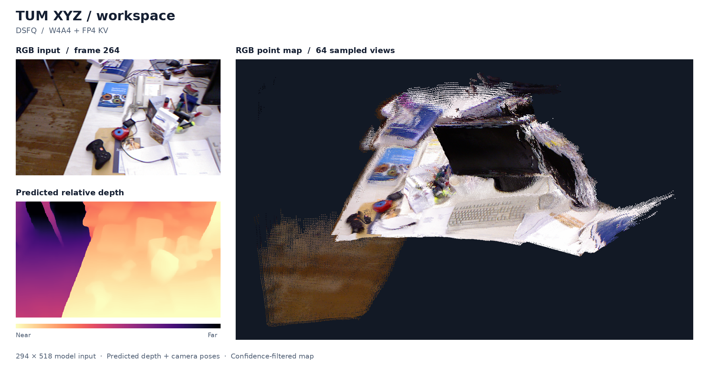
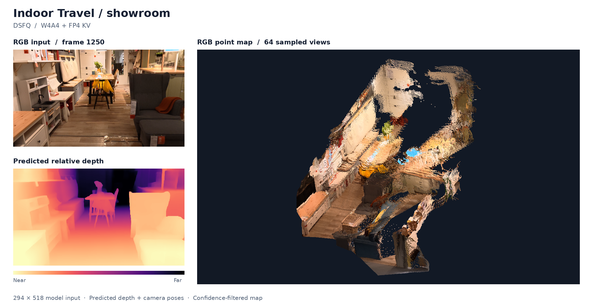
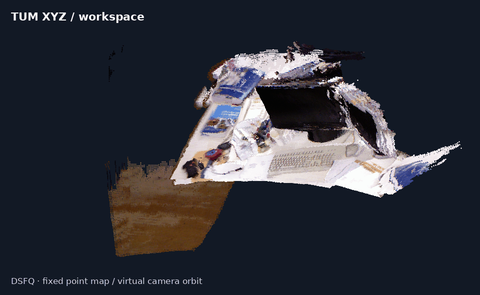
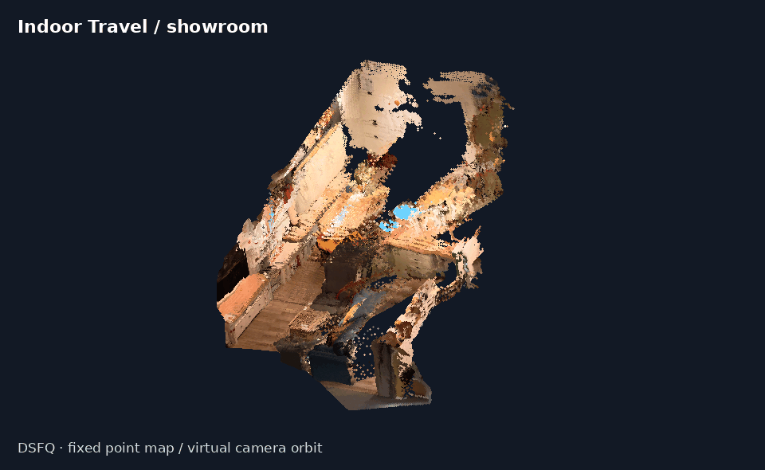
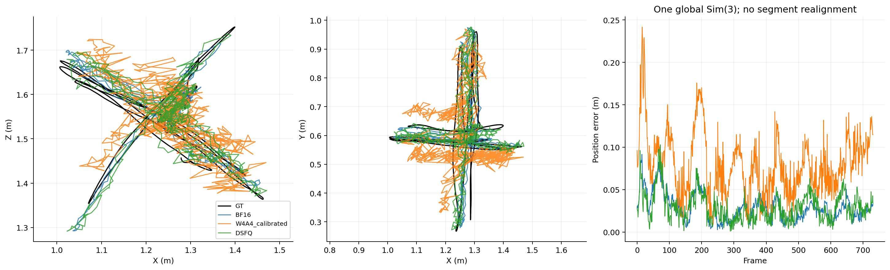
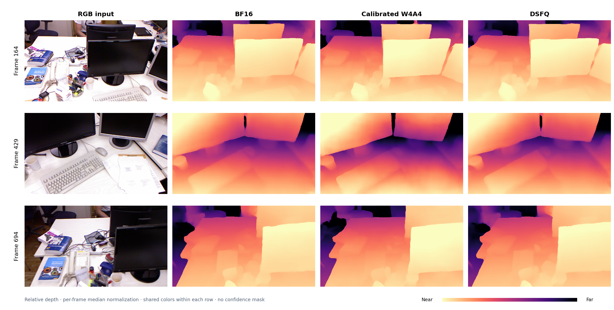
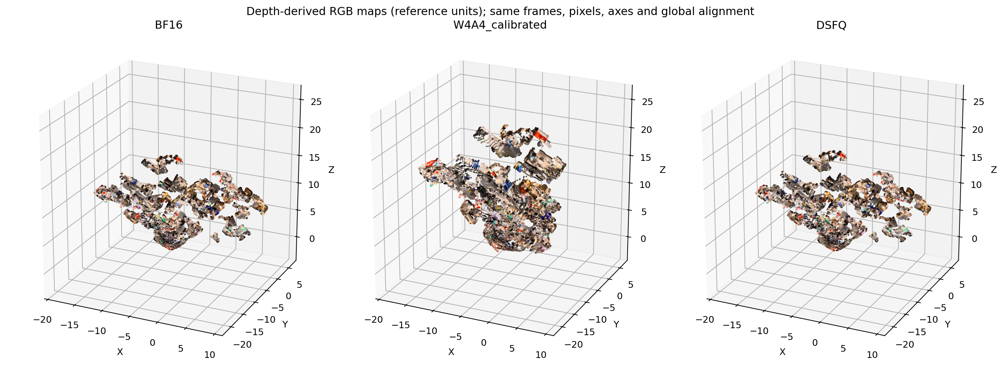

<p align="center"></p>

<h1 align="center">Quantized LingBot-Map</h1>

<p align="center">BF16 · 校准 W4A4 · DSFQ<br>中文 | <a href="README.md">English</a></p>

基于 [LingBot-Map](https://github.com/Robbyant/lingbot-map) 的训练后量化与推理项目，用统一的图像处理和分窗设置比较三种流式三维建图方法。

[GitHub 源码](https://github.com/shuinb/Quantized-LingBot-Map) · [Hugging Face DSFQ 权重与结果](https://huggingface.co/shuinb/Quantized-LingBot-Map)

## 大概改了什么

| 方法 | GCT Linear | 校准方式 | GCT KV 存储 |
|---|---|---|---|
| BF16 | BF16 | 无 | SDPA 使用的 BF16 操作数 |
| 校准直接 W4A4 | 打包 W4，逐 token A4 | LWC/LAC：学习权重/激活裁剪，不加旋转或平滑 | FP4 |
| DSFQ，当前方法 | 打包 W4，逐 token A4 | Hadamard 旋转＋通道平滑＋可学习裁剪 | FP4 |

- 量化 GCT 中的 192 个 Linear。DINO 保留 BF16，相机头和深度头保留 FP32，attention 使用 BF16 SDPA。
- 两种量化使用相同的独立 desk/rpy 校准片段：共 320 帧，每块捕获六个真实流式状态，重构 15 个 epoch，不训练原始模型权重。
- 用压缩 KV、延迟缓存预留、分批初始化和 CUDA Graph 降低显存；保留 294×518 输入、八个锚点、64 帧局部历史和关键帧间隔二。

## 重建展示





<p align="center"> </p>

使用已发布权重重新推理：**GPU0 跑 732 帧 XYZ，GPU1 跑 496 帧 Indoor**，输入仍为 294×518。上图是选取的局部展示：XYZ 第 **200–327** 帧、Indoor 第 **1216–1279** 帧；每张点云均匀采样 64 帧，像素步长为 2，并去除每帧深度置信度最低的 20%。动图展示固定预测点云的虚拟视角旋转，不表示在线建图速度。RGB／深度面板不做置信度遮罩，深度色阶在第 2／98 百分位饱和；没有引入真值几何、网格补全或重新校准。[渲染记录](results/gallery.json) · [复现展示图](docs/visualization.md)。

## 结果与对比

TUM fr1/xyz，732 帧真值评估，数值越低越好：

| 方法 | GT ATE（cm） | 平移 RPE（cm） | 旋转 RPE（°） | 深度 AbsRel（%） |
|---|---:|---:|---:|---:|
| BF16 | 3.312 | 0.826 | 0.362 | 4.149 |
| 校准 W4A4，FP4 KV | 8.805 | 3.844 | 0.966 | 5.600 |
| **DSFQ** | **3.389** | **1.561** | **0.559** | **4.206** |

上表的校准 W4A4 采用 **直接 LWC/LAC＋FP4 KV**。其他计算设置相同时，使用 BF16 KV，校准将 XYZ ATE 从 **8.180 降至 6.183 cm**；使用 FP4 KV，则从 **7.714 变为 8.805 cm**。BF16 KV 对照的 PyTorch allocated 峰值约 9.03 GB。结果仅代表这套校准方法和缓存配置。[核查数据](results/calibration_audit.json) · [诊断图](assets/calibration_audit.png)。





深度网格使用 XYZ 第 164、429、694 帧。每个方法的每帧深度除以自身中位数，同一行再统一采用 BF16 的第 2／98 百分位色阶，不做置信度遮罩。该图比较相对形状，不表示绝对尺度或真值误差。[PDF](assets/depth_comparison.pdf)。

Indoor Travel 5000 帧中均匀选取 64 帧生成的 RGB 点云地图：



恢复 BF16 KV 仍未解决直接 W4A4 的长序列偏离：Indoor 对 BF16 的轨迹 ATE 为 6.041，FP4 KV 时为 5.241，单位均为 BF16 坐标单位。这些是一致性指标，不是真值精度。

[Indoor 全轨迹](assets/trajectory_indoor.png) · [XYZ 点云](assets/mapping_xyz.png) · [XYZ 指标](results/xyz.json) · [Indoor 指标](results/indoor.json)

DSFQ 在单张 RTX 5090 上完成 **5000 帧 × 3 轮**：**进程显存采样峰值 5.876 GB**、PyTorch allocated 峰值 4.814 GB，**最低 11.987 FPS／中位 12.477 FPS**。5090 使用 4-bit 码值＋INT8 GEMM。RTX 3080 的原生 S4 路径另完成 248 帧短测：5.769 GB、5.611 FPS。

DSFQ 的 ATE 和深度 AbsRel 接近 BF16，RPE 仍有差距。位姿采用一次全局 Sim(3) 对齐，GT 深度采用逐帧中位数尺度对齐。Indoor 没有真值，其指标仅表示与 BF16 的一致性。BF16 的 KV／编译设置不同，速度差异不能单独归因于权重量化。显存按十进制 GB 记录，采样覆盖启动到退出，但可能漏过短暂峰值。FPS 包含解码和重叠分窗拼接，不含加载、预热与保存；分窗流程存在输出缓冲。

## 安装

已测环境为 Linux、Python 3.12、PyTorch 2.9.1、CUDA 12.8。每个推理进程使用一张可见 GPU。BF16 需要比量化版更多的空闲显存，完整三方法测量使用 RTX 5090。

```bash
git clone https://github.com/shuinb/Quantized-LingBot-Map.git
cd Quantized-LingBot-Map

python -m pip install torch==2.9.1 torchvision==0.24.1 --index-url https://download.pytorch.org/whl/cu128
python -m pip install -e '.[eval,native]'

# 仅 SM8x（包括 RTX 3080）的原生 S4 路径需要。
git clone --depth 1 --branch v3.5.1 https://github.com/NVIDIA/cutlass.git third_party/cutlass

# 下载原始 LingBot-Map 权重；仓库不包含权重。
hf download robbyant/lingbot-map lingbot-map.pt --local-dir checkpoints
```

原生后端需要带 `nvcc` 的 CUDA toolkit，未自动识别时设置 `CUDA_HOME`。`--backend auto` 在 SM8x 上选择原生 S4，在其他架构上选择 `int8-fused`。后者存储 W4/A4 码值，以整数 INT8 GEMM 执行，不是原生 INT4 指令。本项目不需要安装 FlashInfer、SageAttention 或单独克隆 QuantVGGT。

## 下载已校准的 DSFQ 权重

[Hugging Face 模型仓库](https://huggingface.co/shuinb/Quantized-LingBot-Map) 提供可独立推理的 DSFQ 权重、源码压缩包和已记录结果：

```bash
hf download shuinb/Quantized-LingBot-Map models/dsfq/model.pt \
  --local-dir .
```

下载后可直接执行下方的 DSFQ 推理命令。复现校准或生成直接 W4A4 权重时，继续按照下一节操作。

## 准备数据并校准

从 [TUM RGB-D 官网](https://cvg.cit.tum.de/data/datasets/rgbd-dataset/download) 下载 `fr1/desk`、`fr1/rpy`、`fr1/xyz` 压缩包，放到 `data/archives/`，然后执行：

```bash
for sequence in desk rpy xyz; do
  python -m qmap prepare-tum \
    --archive "data/archives/rgbd_dataset_freiburg1_${sequence}.tgz" \
    --output "data/${sequence}"
done

export CUDA_VISIBLE_DEVICES=0
export OMP_NUM_THREADS=2 MKL_NUM_THREADS=2 OPENBLAS_NUM_THREADS=1 MAX_JOBS=1
export TORCHINDUCTOR_COMPILE_THREADS=1 PYTORCH_ALLOC_CONF=expandable_segments:True

python -m qmap calibrate --method w4a4 --checkpoint checkpoints/lingbot-map.pt \
  --config configs/calibration.json --output models/w4a4
python -m qmap calibrate --method dsfq --checkpoint checkpoints/lingbot-map.pt \
  --config configs/calibration.json --output models/dsfq
```

等待前一条 GPU 命令结束再执行下一条。校准默认把观察阶段的 KV 暂存到 CPU，已在单张 RTX 3080 上实测。使用自己的独立校准片段时，修改 [configs/calibration.json](configs/calibration.json)，图像路径相对于该 JSON；片段应覆盖初始化、局部历史和缓存淘汰。XYZ 与 5000 帧评估数据均不参与量化参数拟合，但它们已用于开发和回归，不能再称为未接触的盲测集。

## 运行三种方法

```bash
python -m qmap infer --method bf16 --checkpoint checkpoints/lingbot-map.pt \
  --images data/xyz/images --start 64 --frames 732 --output runs/xyz_bf16
python -m qmap infer --method w4a4 --deployment models/w4a4/model.pt \
  --images data/xyz/images --start 64 --frames 732 --output runs/xyz_w4a4
python -m qmap infer --method dsfq --deployment models/dsfq/model.pt \
  --images data/xyz/images --start 64 --frames 732 --output runs/xyz_dsfq
```

每次使用新的输出目录，包含 `report.json`、`predictions.pt` 和 `frame_latency.csv`。量化模型可独立部署，推理不需要原始 checkpoint。原生 S4 的默认 allocator 预算为 5.5 GB，INT8 兼容后端为 5.2 GB，CUDA 上下文另计。两种量化方法共享运行默认值，BF16 保留浮点参考配置。流式设置见 [stream.json](qmap/configs/stream.json)。

使用自己的图像时，提供按时间命名的 PNG/JPEG 目录，设置 `--start 0 --frames N`，评估时省略 GT 参数。追加 `--repeats 3` 可重复计时。进程显存采样可包装同一条推理命令，`--gpu` 指物理 GPU 编号：

```bash
python -m qmap memory --gpu 0 --interval 0.05 --output runs/dsfq_memory.json -- \
  python -m qmap infer --method dsfq --deployment models/dsfq/model.pt \
  --images data/xyz/images --start 64 --frames 732 --output runs/xyz_dsfq_measured
```

## 评估与可视化

```bash
python -m qmap evaluate --reference runs/xyz_bf16 \
  --runs BF16=runs/xyz_bf16 W4A4=runs/xyz_w4a4 DSFQ=runs/xyz_dsfq \
  --ground-truth data/xyz/evaluation_gt.npz --ground-truth-manifest data/xyz/manifest.json \
  --output runs/xyz_comparison

python -m qmap visualize \
  --runs BF16=runs/xyz_bf16 W4A4=runs/xyz_w4a4 DSFQ=runs/xyz_dsfq \
  --data data/xyz --output runs/xyz_comparison/visuals --map-frames 64
```

评估输出 JSON／Markdown 对比。可视化输出轨迹 PNG／SVG、RGB 地图 PNG 和彩色 PLY。没有 TUM 真值时，省略两个评估 GT 参数和可视化的 `--data`，将 BF16 放在第一项作为预测参照。评估对应的显存采样运行时，可追加 `--memory-reports DSFQ=runs/dsfq_memory.json`。

从已完成的 DSFQ 推理生成 README 风格的 RGB／深度／点云图及可选动图；渲染步骤只使用 CPU：

```bash
CUDA_VISIBLE_DEVICES='' python -m qmap gallery --run runs/xyz_dsfq \
  --output runs/xyz_gallery --title 'TUM XYZ / workspace' \
  --frame 200 --map-start 136 --map-end 264 --pixel-stride 2 \
  --yaw -25 --elevation 5 --animation-frames 40

CUDA_VISIBLE_DEVICES='' python -m qmap depth-gallery \
  --runs BF16=runs/xyz_bf16 'Calibrated W4A4=runs/xyz_w4a4' DSFQ=runs/xyz_dsfq \
  --frames 100 365 630 --output runs/depth_gallery
```

帧参数均为当前推理序列内从 0 开始的索引。`gallery` 同时输出彩色 PLY 和记录渲染参数的 JSON。Indoor 示例见[可视化用法](docs/visualization.md)。

## 目录与检查

```text
lingbot_map/    模型、量化、KV 缓存和 CUDA 算子
qmap/          校准、推理、评估和可视化入口
configs/       可编辑的独立校准片段配置
assets/        图标与三方法可视化
results/       去除本机路径的实测指标
tests/         量化与流式集成测试
```

```bash
CUDA_VISIBLE_DEVICES='' OMP_NUM_THREADS=2 python -m unittest discover -s tests -v
```

隐藏 CUDA 时，GPU 专项检查会跳过。发布源码不包含 checkpoint、数据集、编译缓存和实验预测文件。

## 致谢与许可

基于 [LingBot-Map](https://github.com/Robbyant/lingbot-map)，量化方法参考 [QuantVGGT](https://github.com/wlfeng0509/QuantVGGT)，原生整数算子使用 [CUTLASS](https://github.com/NVIDIA/cutlass)。署名见 [NOTICE](NOTICE)，Apache-2.0 许可见 [LICENSE](LICENSE)。模型权重和数据集遵循各自原始条款。
